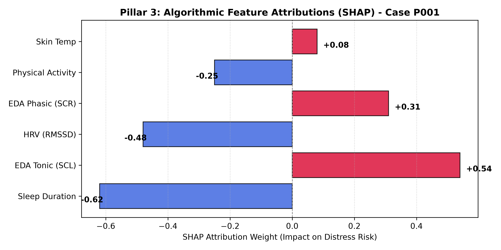
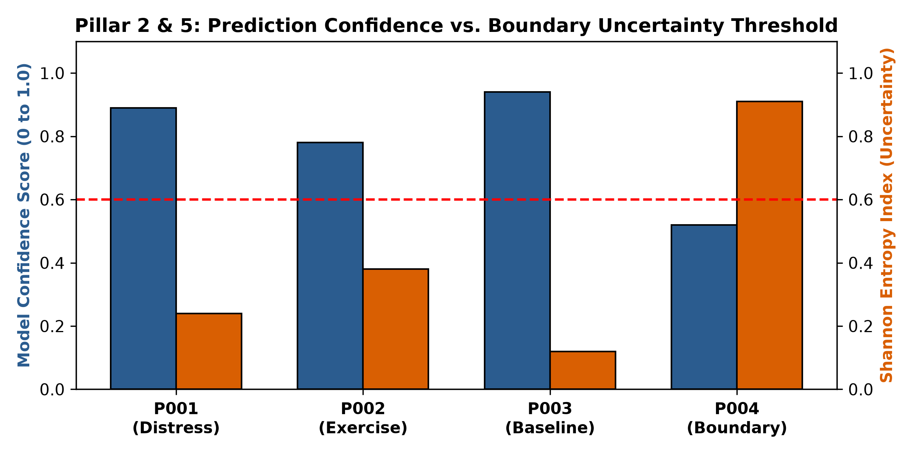

# HC-CTXAI: Human-Centered Context-Aware Explainable AI Framework

[](https://en.wikipedia.org/wiki/Design_science_research)
[](https://archive.ics.uci.edu/dataset/465/wesad+wearable+stress+and+affect+detection)
[](LICENSE)

An open-source prototype implementing the **Human-Centered Context-Aware Explainable Artificial Intelligence (HC-CTXAI)** framework for collaborative early stress risk assessment in IoT-enabled remote mental healthcare. 

This artifact is developed under the **Design Science Research (DSR)** methodology to address critical gaps in conventional physiological stress monitoring: decontextualized inference, the "lab-to-clinic" explainability gap, and the lack of collaborative human-AI teaming.

---

## Architectural Framework

The repository demonstrates the end-to-end operational pipeline across the three interconnected layers formulated in the HC-CTXAI framework:

[IoT Wearables + Context Logs]
│
▼
┌─────────────────────────────────────────────────────────────┐
│ Layer 1: Context-Aware Stress Risk Assessment               │
│ • Multimodal Fusion: HRV (RMSSD), EDA (SCL/SCR), Temp       │
│ • Context Filter: Physical exertion & sleep history         │
│ • Predictive Engine: Multi-class XGBoost with Entropy Bounds│
└────────────────────────────┬────────────────────────────────┘
│ Predictions & Embeddings
▼
┌─────────────────────────────────────────────────────────────┐
│ Layer 2: Human-Centered Explainable Intelligence            │
│ • Algorithmic Attribution: Game-theoretic TreeSHAP weights  │
│ • Dual-Channel Generation:                                  │
│   - Clinician Audit Pack (Technical evidence & drivers)     │
│   - Patient Guidance Pack (Empathetic, non-stigmatizing)    │
└────────────────────────────┬────────────────────────────────┘
│ Tailored Narratives
▼
┌─────────────────────────────────────────────────────────────┐
│ Layer 3: Human-AI Collaborative Decision Support            │
│ • Shared Clinical Decision-Making (Validation & Override)   │
│ • Audit Registry (Automation bias mitigation)               │
└─────────────────────────────────────────────────────────────┘
### Core Methodological Components
1. **Context-Aware Physiological Modeling (Layer 1):** Ingests autonomic biosignals while integrating behavioral context (sleep deficit, physical activity) to prevent false-positive distress alarms triggered by metabolic exertion.
2. **Uncertainty Quantification (Layer 1):** Calculates normalized Shannon Entropy over output class distributions to delineate ambiguous decision boundaries near clinical classification thresholds.
3. **Model-Agnostic Feature Attribution (Layer 2):** Extracts exact local Shapley values via TreeSHAP to expose individual feature contributions.
4. **Dual-Stakeholder Dissemination (Layer 2):** Decouples technical diagnostic evidence for clinicians from supportive, action-oriented self-care guidance for patients.
5. **Clinical Agency & Override Audit (Layer 3):** Preserves clinician authority via validation and override controls, logging rationale to calibrate future models and prevent automation bias.

---

## Experimental Demonstrations & Artifacts

The prototype evaluates simulated clinical scenarios derived from real-world telemetry baselines:

### 1. Local Algorithmic Feature Attribution (SHAP)
Quantitative evaluation of autonomic and contextual drivers for an individual with acute stress accumulation (Case P001):



### 2. Uncertainty Boundary Calibration
Comparative distribution of model confidence versus prediction entropy across diverse patient vignettes:



*When prediction entropy exceeds the predefined threshold (Case P004), the framework withholds autonomous dispatch and escalates the case for clinician manual review.*

---

## Clinical Vignettes Included

| Vignette ID | Scenario Profile | Autonomic Marker Pattern | Contextual Confounders | Expected System Behavior |
| :--- | :--- | :--- | :--- | :--- |
| **P001** | Cumulative Stress Distress | Suppressed HRV (21.5 ms), High EDA | Restricted Sleep (4.2 h) | High Risk alert; triggers dual-channel explanations. |
| **P002** | Exercise-Induced Arousal | Elevated EDA, High Heart Rate | Active Jogging (Exertion = 1) | Context filter prevents false distress classification. |
| **P003** | Normative Baseline | Normal HRV (65.2 ms), Low EDA | Regular Sleep (8.0 h) | Low Risk confirmation; positive wellness feedback. |
| **P004** | Borderline Ambiguity | Intermediate HRV & EDA fluctuation | Marginal Sleep (5.8 h) | Elevated entropy flagged; triggers clinical override protocol. |

---

## Repository Structure

```text
├── assets/
│   ├── shap_attributions.png          # Generated SHAP attribution plots
│   └── uncertainty_calibration.png    # Entropy vs. confidence calibration curves
├── data/
│   └── patients_data.csv              # Standardized clinical vignette dataset
├── demo_hc_ctxai.py                   # Automated end-to-end framework execution script
├── generate_visuals.py                # Visual artifact generation script
├── requirements.txt                   # Computational dependencies
├── .gitignore                         # Build and cache exclusion rules
└── README.md                          # Technical and methodology documentation
